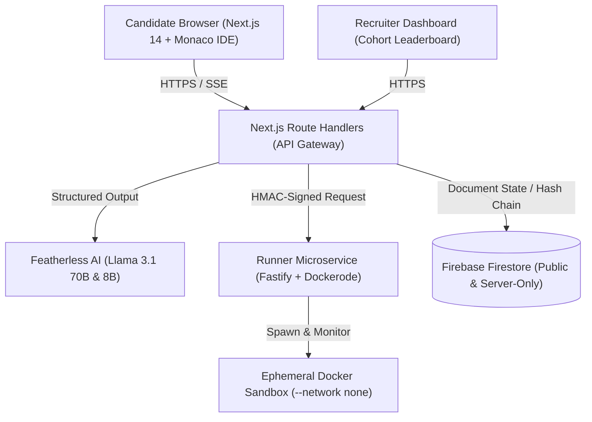

# 🚀 CBIT Hacktoberfest '26 — PROCTOR-FORGE

> **Official Public Submission for CBIT Hacktoberfest '26**  
> *Chaitanya Bharathi Institute of Technology (CBIT), Hyderabad*

---

## 📋 Team Information

| Attribute | Details |
| :--- | :--- |
| **Team Name** | **Cyber Attack** |
| **Team Number** | **TEAM-32 (HFT26-TEAM-32)** |
| **Registration ID** | **HFEST26-DXVHMERW** |
| **Problem Track** | **General Track** |
| **Team Leader** | **D Aswin** ([aswindhoma05@gmail.com](mailto:aswindhoma05@gmail.com)) |
| **Institution** | **St Martin's Engineering College** |

### 👥 Team Members

| # | Name | Email | Institution |
| :-: | :--- | :--- | :--- |
| 1 | **Enoch Miechel** | [enochcws123@gmail.com](mailto:enochcws123@gmail.com) | St Martin's Engineering College |
| 2 | **H Lakuma** | [hlakuma5@gmail.com](mailto:hlakuma5@gmail.com) | St Martin's Engineering College |
| 3 | **Samanvitha Bhoosa** | [samanvithabhoosa06@gmail.com](mailto:samanvithabhoosa06@gmail.com) | St Martin's Engineering College |

---

# PROCTOR-FORGE
> **Portfolio-Driven Adaptive Coding & Technical Assessment Platform with Live Facial Biometrics & DeepSeek-V4-Pro Guarded Proctoring**  
> *Built by Team **Cyber Attack** (Team 32).*

[](https://github.com/team-cyber-attack/proctor-forge)
[](https://opensource.org/licenses/MIT)
[](https://nodejs.org/)
[](https://www.docker.com/)

---

## 1. Problem Statement & Mission

Traditional technical evaluations force candidates into generic LeetCode puzzles completely detached from their actual projects, while generative AI enables pervasive cheating.

**PROCTOR-FORGE** transforms candidate evaluation:
1. **Portfolio-Driven:** Ingests structured JSON portfolios (projects, stack, skills, solved DSA topics).
2. **Strictly Claim-Bounded:** Generated DSA problems are mathematically restricted to topics claimed in the portfolio.
3. **Mandatory Pre-Release Validation Gate:** Every task is validated before release — reference solutions pass 100%, starter code fails designated tests, and test suites kill $\ge 70\%$ of mutants.
4. **100% Deterministic Grading:** An LLM **never** assigns points or judges correctness. 80% is scored by native unit test assertions in isolated Docker sandboxes; 20% is scored from interaction logs.
5. **Guarded Technical Assistant:** Pedagogical AI mentor on Adept/Master tasks with strict input/output firewalls and prompt injection defenses.
6. **Tamper-Evident Reporting:** Immutable SHA-256 telemetry event hash chains and cryptographically signed reports with public verification.

---

## 2. Hard Requirements Compliance Checklist

| Requirement | Implementation Status | Core File(s) |
| :--- | :---: | :--- |
| **DSA questions strictly bounded to claimed topics** | Verified ✔ | `packages/shared/src/schemas/portfolio.ts`<br>`apps/web/src/lib/pipeline/orchestrator.ts` |
| **Task domain matches candidate domain & stack** | Verified ✔ | `packages/shared/src/schemas/task.ts`<br>`packages/task-bank/src/` |
| **Pre-release validation gate with mutation testing** | Verified ✔ | `packages/task-bank/src/bank-validator.ts`<br>`packages/task-bank/src/mutations/mutators.ts` |
| **100% deterministic grading (no LLM score judging)** | Verified ✔ | `packages/shared/src/scoring/grading-engine.ts` |
| **Guarded AI assistant with context minimization** | Verified ✔ | `packages/shared/src/security/input-firewall.ts`<br>`apps/web/src/app/api/assistant/route.ts` |
| **Deterministic AI efficiency score (up to 20 pts)** | Verified ✔ | `packages/shared/src/scoring/ai-efficiency.ts` |
| **Featherless AI client with backoff & repair** | Verified ✔ | `apps/web/src/lib/featherless/client.ts` |
| **Hardened sandbox runner service with HMAC auth** | Verified ✔ | `apps/runner/src/sandbox/docker-pool.ts`<br>`apps/runner/src/auth/hmac-auth.ts` |
| **Client telemetry & SHA-256 hash-chain audit log** | Verified ✔ | `packages/shared/src/security/hash-chain.ts`<br>`apps/web/src/lib/telemetry/tracker.ts` |
| **Pre-authored 24-task fallback bank** | Verified ✔ | `packages/task-bank/src/tasks/` |
| **Claim Verification Index (CVI)** | Verified ✔ | `packages/shared/src/scoring/claim-verification.ts` |
| **Session Replay timeline scrubber** | Verified ✔ | `apps/web/src/app/replay/[id]/page.tsx` |
| **One-Click Judge Demo Mode (3-min)** | Verified ✔ | `apps/web/src/app/api/demo/route.ts`<br>`docs/DEMO-SCRIPT.md` |

---

## 3. System Architecture



---

## 4. Tech Stack

- **Monorepo:** pnpm workspaces (`apps/web`, `apps/runner`, `packages/shared`, `packages/task-bank`, `infra/`)
- **Frontend:** Next.js 14 (App Router), TypeScript, Tailwind CSS, Monaco Editor, Recharts, Framer Motion, Zustand
- **Backend API:** Next.js Route Handlers + Firebase Admin SDK
- **Database & Auth:** Firebase Firestore, Authentication, Emulator Suite
- **LLM Engine:** Featherless AI (OpenAI-compatible chat completions)
- **Code Execution Runner:** Node.js + Fastify + dockerode in ephemeral containers (`--network none`, read-only root FS, tmpfs, `--cap-drop ALL`, non-root user)
- **Testing:** Vitest, Python unittest

---

## 5. Quick Start & Local Run

### Prerequisites
- Node.js 20+
- pnpm 8+
- Docker Engine (optional; in-process sandbox fallback active for local testing)

### Installation
```bash
# Clone the repository
git clone https://github.com/team-cyber-attack/proctor-forge.git
cd proctor-forge

# Install workspace dependencies
pnpm install

# Setup environment variables
cp .env.example .env

# Validate pre-authored Task Bank (runs mutation tests across all 24 tasks)
pnpm run validate-bank

# Run all unit tests
pnpm run test
```

### Starting the Platform
```bash
# Start Firebase emulators (in a separate terminal)
pnpm run emulators

# Seed database with sample portfolios, bank tasks, and completed reports
pnpm run seed

# Start both Web App and Sandbox Runner concurrently
pnpm run dev
```

Visit `http://localhost:3000` to launch the platform.

---

## 6. One-Click Judge Demo Mode

Judges can test the entire pipeline in **under 3 minutes**:
1. Click the **"Judge Demo (3-Min)"** button on the top navigation bar.
2. An accelerated 10-minute assessment will launch immediately with pre-validated tasks.
3. Code in Monaco, run visible tests against isolated runners, unlock guarded hints, and observe prompt injection blocks.
4. Click **"Submit Assessment"** to inspect the signed report, Claim Verification Index, and Session Replay.

Refer to [`docs/DEMO-SCRIPT.md`](docs/DEMO-SCRIPT.md) for the timed presenter guide.

---

## 7. Open-Source Libraries Credit
- Monaco Editor (`@monaco-editor/react`)
- Dockerode (`dockerode`)
- Fastify (`fastify`)
- Zod (`zod`)
- Tailwind CSS (`tailwindcss`)
- Lucide React (`lucide-react`)
- Vitest (`vitest`)

