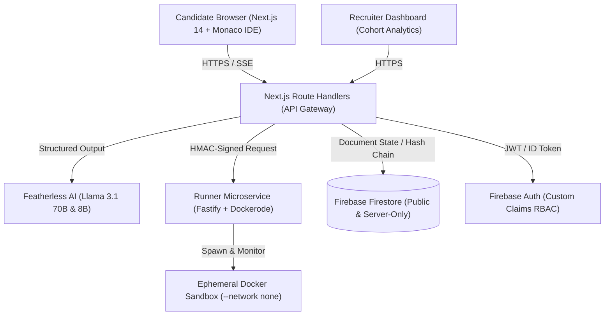
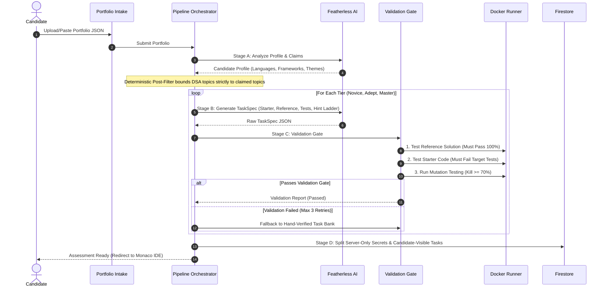

# PROCTOR-FORGE: Architectural Blueprint

## 1. System Component Architecture



## 2. Assessment Generation Pipeline



## 3. Guarded AI Assistant Architecture (Defense in Depth)

```mermaid
flowchart TD
    UserMsg["Candidate User Message"] --> InFirewall{"Input Firewall Inspection"}
    InFirewall -->|Jailbreak / Prompt Injection / Solution Demand| Refusal["Refuse Request + Log Extraction Attempt Telemetry"]
    InFirewall -->|Valid Conceptual Question| ContextBuilder["Context Minimization Builder"]
    
    ContextBuilder --> ContextData["Context: Problem + Current Code + Sanitized Test Names + Unlocked Hint ONLY"]
    Note over ContextData: Reference Solution & Hidden Tests are STRICTLY EXCLUDED
    
    ContextData --> LLMCall["Featherless AI (Technical Mentor Persona)"]
    LLMCall --> OutFirewall{"Output Firewall Inspection"}
    
    OutFirewall -->|Canary Token Detected| CannedFallback["Block Leak + Canned Fallback"]
    OutFirewall -->|Code Line Limit Exceeded| CannedFallback
    OutFirewall -->|N-Gram Match with Reference Solution| CannedFallback
    OutFirewall -->|Clean Guidance| StreamClient["Sentence-Buffered SSE Stream to Candidate"]
```

## 4. Hardened Sandbox Isolation Boundary

```mermaid
graph LR
    subgraph Host VM
        RunnerService["Fastify Runner Service"]
        subgraph Ephemeral Container
            direction TB
            User["User: sandboxuser (UID 1001)"]
            Net["Network: NONE"]
            FS["Read-Only Root Filesystem"]
            Tmpfs["Mounted /tmp (tmpfs: 64MB)"]
            Limits["Pids: 64 | RAM: 256MB | CPU: 1.0 core"]
            Seccomp["Seccomp: Banned ptrace, bpf, reboot, mount"]
            Harness["Nonce-Delimited Test Harness Channel"]
        end
    end
    RunnerService -->|Mount Scratch| Ephemeral Container
```

